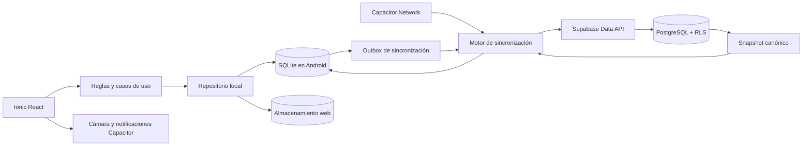

# HoneyFlower

[](https://github.com/Tubiruchi/Honey_Flower/actions/workflows/ci.yml)

Aplicación móvil híbrida y offline-first para construir hábitos de hidratación y uso de protector
solar. HoneyFlower convierte la constancia semanal en un jardín: cada ciclo completado puede sumar
una planta viva, mientras que los ciclos no alcanzados permanecen disponibles en el historial de
plantas marchitas.

La aplicación funciona localmente sin conexión y sincroniza los cambios de cuentas autenticadas con
Supabase cuando la red vuelve a estar disponible. La versión actual de la aplicación es **0.4.3** y el
paquete Android usa el identificador `com.honeyflower.app`.

## Funcionalidad

- Onboarding para configurar nombre, especie inicial, metas, horarios, notificaciones y zona horaria.
- Registro, confirmación de correo, inicio de sesión, recuperación de contraseña y cierre de sesión.
- Registro de agua mediante cantidades rápidas, cantidad personalizada y captura temporal con cámara.
- Registro de protector solar por citas, con ventanas de 60 minutos y una sola confirmación por cita.
- Historial diario con filtros, edición, eliminación y deshacer sobre operaciones confirmadas.
- Inicio con progreso de agua, protector, racha, calendario operativo y estado actual de la planta.
- Análisis por mes con jardines de plantas vivas y marchitas, además del progreso del ciclo.
- Perfil con estadísticas, metas, horarios, preferencias de notificación y estado de sincronización.
- Notificaciones locales programadas en Android y simulación controlada en el entorno web.
- Uso como invitado con datos exclusivamente locales o como cuenta con sincronización remota.

## Arquitectura

HoneyFlower usa una arquitectura offline-first. La interfaz nunca depende de una respuesta remota para
confirmar una acción local: primero escribe en el almacenamiento del dispositivo y después entrega la
operación pendiente al servidor.



### Persistencia local

- Android usa `@capacitor-community/sqlite` con una base independiente para invitado y para cada UUID
  autenticado.
- Las migraciones locales son transaccionales, activan llaves foráneas y utilizan WAL.
- Cada mutación de una cuenta se confirma junto con su entrada de outbox en la misma transacción.
- El navegador utiliza un adaptador de almacenamiento web para desarrollo, Storybook y pruebas.
- Los intentos temporales, recibos y preferencias se validan antes de sustituir datos confirmados.

### Sincronización remota

- `@capacitor/network` detecta desconexiones y reintenta al recuperar conectividad.
- Las operaciones mantienen un `operation_id` estable para permitir reintentos idempotentes.
- Supabase Auth proporciona la sesión y el JWT usado por Row Level Security.
- La Data API recibe operaciones pendientes; PostgreSQL valida y actualiza la proyección canónica.
- La descarga por cursor reconstruye SQLite únicamente cuando no apareció otra escritura local.
- Rechazos y conflictos conservan un recibo de auditoría y generan una revisión visible en la app.
- Invitados, rutas locales y archivos de cámara no se sincronizan.

## Tecnologías

| Área                 | Tecnologías                                                                |
| -------------------- | -------------------------------------------------------------------------- |
| Aplicación           | React 19, Ionic React 9, React Router 7, TypeScript 5                      |
| Compilación          | Vite 8, npm workspaces                                                     |
| Android              | Capacitor 8, Java 21, Android SDK 36                                       |
| Persistencia         | SQLite nativo, almacenamiento web y repositorios transaccionales           |
| Backend              | Supabase Auth, Data API, PostgreSQL, funciones SQL y Row Level Security    |
| Diseño               | Storybook 10, tokens compartidos, Plus Jakarta Sans y recursos desde Figma |
| Pruebas              | Node Test Runner, Vitest Browser, Playwright y Storybook Accessibility     |
| Integración continua | GitHub Actions                                                             |

## Requisitos

### Desarrollo web

- Git.
- Node.js **24.13.0**; la versión está fijada en `.nvmrc`.
- npm **11**.
- Chromium para ejecutar las pruebas de Storybook.

### Desarrollo Android

- Android Studio con Java 21, o un JDK 21 compatible.
- Android SDK 36 y Android Build Tools.
- Windows PowerShell para el script automatizado de construcción de la APK.

La aplicación declara `minSdkVersion 24`, equivalente a Android 7.0 o posterior.

## Instalación

```sh
git clone https://github.com/Tubiruchi/Honey_Flower.git
cd Honey_Flower
npm ci
```

Crear la configuración local a partir del ejemplo:

```powershell
Copy-Item apps/mobile/.env.example apps/mobile/.env.local
```

En macOS o Linux:

```sh
cp apps/mobile/.env.example apps/mobile/.env.local
```

El archivo `.env.local` está ignorado por Git.

## Variables de entorno

La conexión de cuentas y sincronización requiere dos variables en `apps/mobile/.env.local`:

```dotenv
VITE_SUPABASE_URL=https://<project-ref>.supabase.co
VITE_SUPABASE_PUBLISHABLE_KEY=sb_publishable_<clave-publica>
```

| Variable                        | Uso                                                  |
| ------------------------------- | ---------------------------------------------------- |
| `VITE_SUPABASE_URL`             | URL pública del proyecto Supabase.                   |
| `VITE_SUPABASE_PUBLISHABLE_KEY` | Clave pública para Auth y Data API desde el cliente. |

Solo debe utilizarse una clave `sb_publishable_...`. Las claves secretas, `service_role`, contraseñas
de base de datos y cadenas de conexión no pertenecen al cliente ni al repositorio.

Sin estas variables, la aplicación puede ejecutarse en modo local, pero el registro, el inicio de
sesión y la sincronización remota permanecen deshabilitados.

### Redirecciones de autenticación

El proyecto Supabase debe permitir los destinos utilizados por la aplicación:

```text
http://127.0.0.1:5173/cuenta/callback
http://127.0.0.1:5173/cuenta/callback?flow=recovery
honeyflower://auth/callback
honeyflower://auth/callback?flow=recovery
```

Si se desarrolla con `localhost` en lugar de `127.0.0.1`, ese origen debe registrarse por separado.
Los enlaces de confirmación y recuperación usan PKCE y deben abrirse en el mismo dispositivo donde se
inició la solicitud.

## Ejecución local

Iniciar la aplicación web:

```sh
npm run dev
```

La aplicación queda disponible en <http://127.0.0.1:5173>.

Iniciar el catálogo de componentes:

```sh
npm run storybook
```

Storybook queda disponible en <http://127.0.0.1:6006>.

Para revisar una compilación de producción:

```sh
npm run build
npm run preview
```

## Supabase

El esquema remoto está versionado en `supabase/migrations` y debe aplicarse en orden cronológico:

1. `create_sync_foundation`: crea perfiles, preferencias, ciclos, metas, horarios, registros,
   operaciones, checkpoints y dispositivos.
2. `process_sync_operations`: valida la outbox y actualiza la proyección canónica en una transacción.
3. `pull_sync_snapshot`: expone una lectura autenticada y limitada por RLS para reconstruir SQLite.

Las tablas públicas tienen RLS habilitado. Las proyecciones canónicas son de solo lectura para la app;
el cliente puede insertar operaciones pendientes y administrar únicamente el cursor de sus propias
instalaciones. El procesador remoto no puede invocarse directamente desde el rol autenticado.

Las pruebas SQL de sincronización están en `supabase/tests/process_sync_operations.sql` y se ejecutan
dentro de una transacción con `ROLLBACK`, por lo que no conservan fixtures.

## Colección Postman

La colección exportada está en:

```text
postman/HoneyFlower-Avance3.postman_collection.json
```

Incluye autenticación, validación de RLS, operaciones `GET`, `POST`, `PUT` y `DELETE` sobre una
instalación temporal, consulta de recibos y descarga del snapshot canónico. La última petición elimina
la instalación creada durante la prueba.

Después de importarla en Postman, completar estas variables de la colección:

- `publishable_key`
- `test_email`
- `test_password`

El URL de Supabase puede sustituirse mediante `supabase_url`. Los tokens y el UUID del usuario se
obtienen en tiempo de ejecución y no están incluidos en el archivo.

Validar la estructura de la colección sin realizar peticiones externas:

```sh
npm run test:postman
```

## Pruebas y calidad

Instalar Chromium una vez antes de ejecutar las pruebas visuales:

```sh
npm exec --workspace @honeyflower/mobile -- playwright install chromium
```

| Comando                   | Verificación                                                      |
| ------------------------- | ----------------------------------------------------------------- |
| `npm run check`           | Tokens, ESLint, TypeScript y formato.                             |
| `npm run test:onboarding` | Reglas y navegación del onboarding.                               |
| `npm run test:local`      | Dominio, SQLite, cámara, avisos, repositorios y sincronización.   |
| `npm run test:postman`    | Estructura, métodos y protección de credenciales de la colección. |
| `npm run test-storybook`  | Historias, interacciones y accesibilidad en Chromium.             |
| `npm test`                | Suite completa de pruebas.                                        |
| `npm run build`           | Compilación de producción de la aplicación.                       |
| `npm run build-storybook` | Catálogo estático de Storybook.                                   |

Los resultados generados se escriben en `apps/mobile/dist` y `apps/mobile/storybook-static`; ambos
directorios están ignorados por Git.

## Android

Sincronizar los recursos web y plugins con el proyecto nativo:

```sh
npm run android:sync
```

Abrir el proyecto en Android Studio:

```sh
npm run android:open
```

En Windows, generar una APK de prueba desde la raíz del repositorio:

```sh
npm run apk:build
```

El script compila la aplicación web, sincroniza Capacitor, ejecuta Gradle, verifica la firma de depuración
y crea el APK junto con su SHA-256 en `artifacts/android`.

Para compartir temporalmente la APK con un teléfono en la misma red local:

```sh
npm run apk:serve
```

El servidor imprime la dirección local de descarga y solo expone la APK y su icono. Esta construcción es
para pruebas; no sustituye una compilación de publicación firmada para una tienda.

## Estructura del repositorio

```text
.
├── .github/workflows/       Integración continua
├── apps/mobile/
│   ├── android/             Proyecto nativo Capacitor
│   ├── src/
│   │   ├── app/             Arranque, rutas y proveedores globales
│   │   ├── assets/          Recursos visuales versionados
│   │   ├── features/        Funcionalidades organizadas por dominio
│   │   ├── shared/
│   │   │   ├── components/  Componentes reutilizables y sus historias
│   │   │   ├── data/        Repositorios, SQLite y sincronización
│   │   │   ├── native/      Adaptadores de cámara, red y notificaciones
│   │   │   └── styles/      Estilos compartidos
│   │   └── stories/         Documentación y composiciones de Storybook
│   └── tests/               Pruebas de dominio e integración local
├── packages/
│   ├── contracts/           Contratos TypeScript compartidos
│   └── design-tokens/       Tokens fuente y CSS generado
├── postman/                 Colección REST exportada
├── scripts/                 Construcción, validación y utilidades
└── supabase/
    ├── migrations/          Esquema PostgreSQL versionado
    └── tests/               Pruebas transaccionales del backend
```

## Seguridad y privacidad

- La autorización remota depende del JWT de Supabase Auth y políticas RLS basadas en `auth.uid()`.
- Las claves privadas y credenciales de base de datos nunca se incluyen en el bundle móvil.
- Las tablas canónicas no aceptan escrituras directas del cliente.
- Las operaciones remotas son idempotentes y se validan antes de modificar la proyección del usuario.
- Cada cuenta mantiene una base SQLite aislada; cerrar sesión no mezcla datos con otra cuenta.
- Las fotografías de cámara son temporales y no se envían a Supabase.
- Los mensajes públicos de error evitan exponer respuestas técnicas, tokens o credenciales.

## Integración continua

GitHub Actions ejecuta en cada pull request y en cada cambio de `main`:

1. Instalación reproducible mediante `npm ci`.
2. Validación de código, tokens, tipos y formato.
3. Suite completa de pruebas con Chromium.
4. Compilación de la aplicación y Storybook.
5. Publicación temporal del catálogo estático como artefacto del workflow.

## Limitaciones actuales

- La captura de agua permite cámara, vista previa y confirmación manual, pero todavía no integra un
  modelo de reconocimiento automático.
- La APK generada por el script es una construcción de depuración destinada a pruebas internas.
- La sincronización entre múltiples dispositivos requiere validación adicional en teléfonos físicos.
- Las revisiones con TalkBack, señal de linterna y comportamiento específico de fabricantes Android se
  realizan por separado de las pruebas automatizadas del navegador.

## Responsable

Proyecto mantenido por [Pedro Ortegón (`Tubiruchi`)](https://github.com/Tubiruchi).
